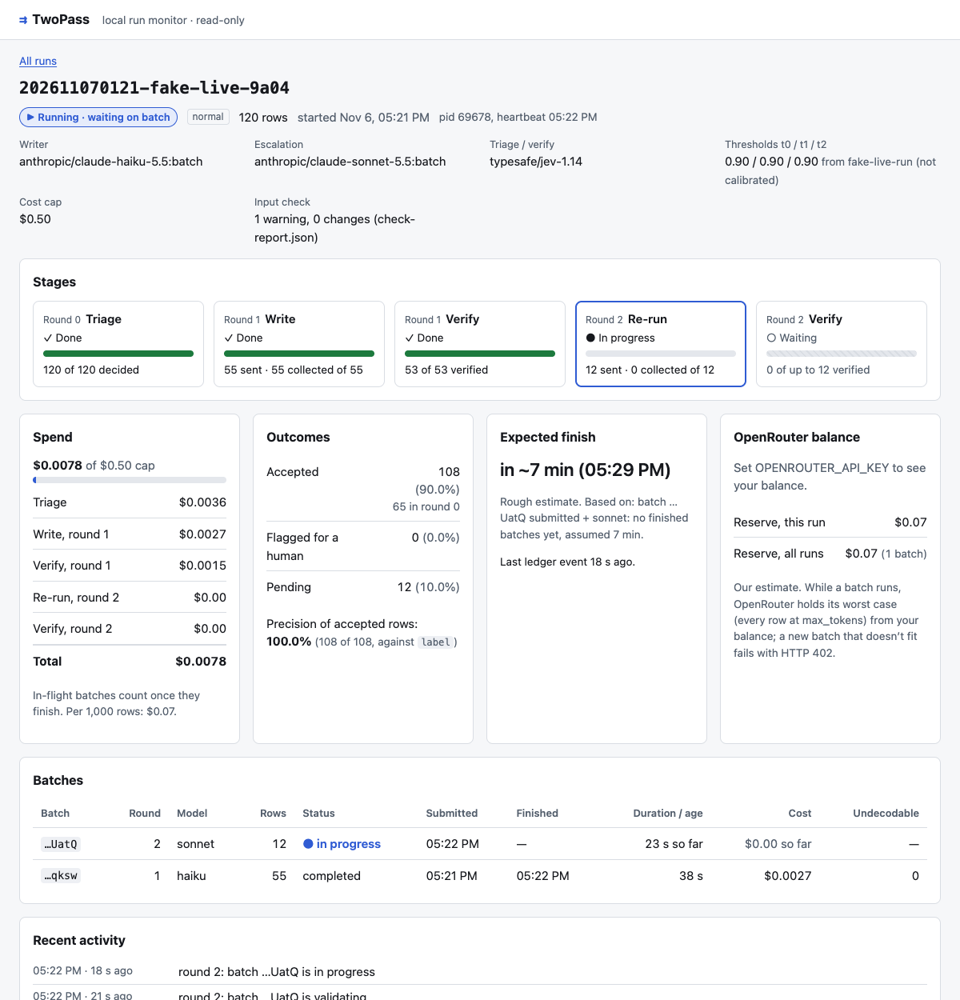
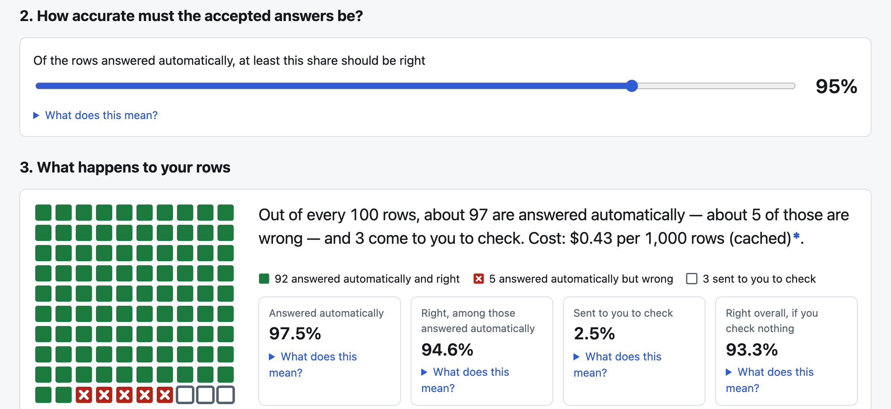
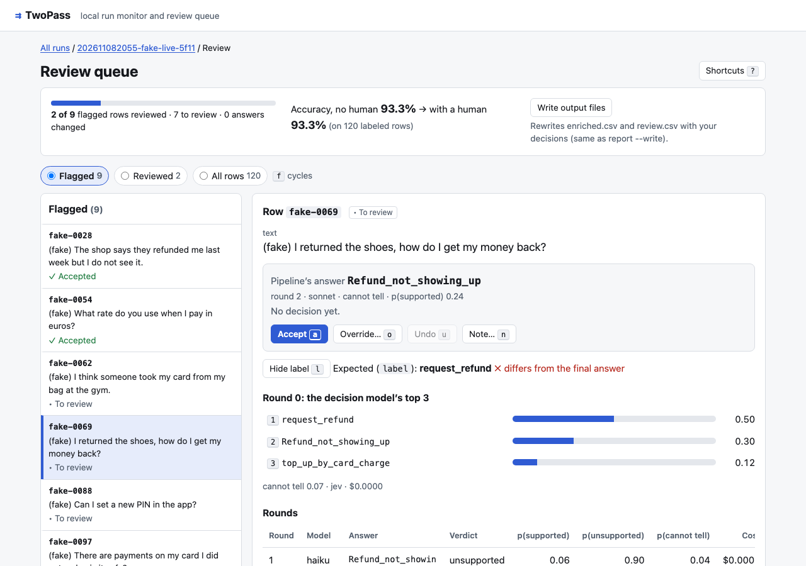

# TwoPass

**Run repetitive LLM work at batch prices, with a cheap decision model checking every row.** Rows it trusts are
accepted. Rows it doubts are re-run on a stronger model, and whatever is still uncertain goes to a human.

On the full Banking77 test split, with Cloudflare's Clef as the controller:

> **3,080 rows · 3,002 auto-accepted at 96% precision · 79 re-run · 78 need a look · $1.31 · 159 min**

That's 94.3% end-to-end accuracy for $0.43 per 1,000 rows. A frontier model (Claude Opus 5.5) answering every row
got 88.1% for $0.45 per 1,000 rows. With prompt caching on both sides, TwoPass costs about the same as the frontier
model and is about 6 points more accurate, with 2.5% of rows sent to a person. See [Results](#results), and the
[caveats](#limitations) before quoting this.

Earlier numbers were higher because those runs had no prompt caching: every row paid full price for the same
~1,940-token label list, which hit the Opus baseline hardest. Without prompt caching (2026-11-06): $0.48 vs $4.13 per 1k,
8.7× cheaper (8.68 from the unrounded costs, $0.47595 and $4.12959; the prices rounded to cents give 8.6).

## How it works

```
CSV ──► Round 0: triage       decision model picks the answer itself (closed-choice tasks only)
          │ confident ──────────────────────────────────────────────► ACCEPTED
          ▼
        Round 1: batch write  cheap writer model, OpenRouter Batch API
        Verify                decision model: supported / unsupported / cannot_tell
          │ supported & confident ──────────────────────────────────► ACCEPTED
          ▼
        Round 2: batch re-run stronger model, rejected rows only
        Verify ─────────────────────────────────────────────────────► ACCEPTED or FLAGGED → human
```

- **Decision models** (Jev, Clef, Luna Decisions on OpenRouter) don't generate text. They return a typed answer with
  probabilities, for fractions of a cent per call.
- **Thresholds are fitted, not guessed.** `twopass calibrate` fits each stage's threshold on held-out labeled data to
  reach a target precision. It also reports calibration error before and after isotonic calibration.
- **Every question offers `cannot_tell`.** Decision models rarely abstain unless they're given the option.
- **Nothing is lost or paid twice.** Every result is written to an append-only ledger as it arrives. Kill the
  process at any point, then run `twopass resume`.

This is a workflow with a learned controller, not an autonomous agent. The steps are fixed, and the decision model
only chooses which way each row goes.

## Quick start

Requirements: Node ≥ 22.18, pnpm, and an [OpenRouter](https://openrouter.ai) API key with credit.

```bash
git clone https://github.com/Rubick1997/twopass.git && cd twopass
pnpm install
export OPENROUTER_API_KEY=sk-or-...

# a small end-to-end benchmark: about $0.20 (it cost $0.18 on 2026-11-10), capped at $1 by --max-usd
# (the first run also downloads Banking77, a minute or two)
node src/cli.ts bench banking77 --calibration-size 60 --test-size 40 --max-usd 1
```

Almost all of the time is waiting for the provider's batch queue: several batch rounds, each 4–8 minutes on a quiet
day and hours on a busy one: on 2026-11-10 the whole command took 8.5 hours, 7 of them on the first 60-row batch
(see [Limitations](#limitations)). The command prints one line per batch and
is silent while a batch waits. If you stop it, run the same command again with `--id <benchId>` (printed on the first
line) and it continues without paying twice.

To run your own CSV:

```bash
node src/cli.ts run my.csv --task tasks/my.task.ts --max-usd 2
node src/cli.ts resume <runId>       # after a crash, a cost-cap stop, or Ctrl-C
node src/cli.ts report <runId>
```

### Preparing your CSV

Check a CSV before spending anything. It calls no model (only OpenRouter's public model list, for context lengths):

```bash
node src/cli.ts check my.csv --task tasks/my.task.ts --label expected   # --label is optional
```

`run` and `bench` do the same check automatically and refuse to start on errors, before any network call.

**What the CSV needs:** a header row with unique, non-empty column names; every column the task reads (its
`{{placeholders}}`, `inputColumns` and `idColumn`); unique, non-empty ids; the same number of cells in every row; and
at least one data row.

**What `check` fixes, logging every change** (the input file is never modified; a normalized copy is written):
Windows-1252 → UTF-8, a byte-order mark, `,` `;` tab or `|` delimiters (auto-detected), CRLF line endings, Unicode
NFC, zero-width and control characters, surrounding whitespace, empty rows, and labels that differ only in case,
spaces or hyphens (`Card Arrival` → `card_arrival`) when exactly one allowed label matches.

**What it refuses:** undecodable or empty files, ragged rows, missing columns (with "did you mean" suggestions),
empty or duplicate ids, labels outside the task's output schema, and rows likely too long for a model's context.

**What it warns about** (the run proceeds): empty values, duplicate inputs, possible personal data (emails, phone
numbers, Luhn-valid card numbers, mod-97-valid IBANs; reported by row number only, never printed), too few labeled
rows for calibration, and cells a spreadsheet could run as formulas. TwoPass escapes those in its own output CSVs.

Each run writes `runs/<runId>/`:

| File | What it holds |
|---|---|
| `enriched.csv` | Your columns plus `answer, confidence, verdict, model, round, cost_usd, status`, and from review: `reviewed_by_human` (`accepted` / `overridden`), `final_answer` (yours where you decided, else the pipeline's) and `review_note`. `answer` stays the pipeline's |
| `review.csv` | Only the flagged rows nobody has reviewed yet |
| `overrides.jsonl` | Your review decisions, one line each (see below). Never part of the ledger |
| `manifest.json` | Pinned model IDs, thresholds, prices, the task file's and input's hashes |
| `normalized.csv`, `check-report.json` | The input as the run used it, and every change and warning from `check` |
| `ledger.jsonl` | Every call and result, in order |
| `run.lock` | Only while a process works on the run: its pid and a heartbeat (see below) |

### Watching a run

Batch rounds take minutes to hours. `twopass ui` opens a local page that shows every run and bench in your `runs/`
folder, updating every 3 seconds:

```bash
pnpm build                          # once: builds the CLI and the UI
node src/cli.ts ui                  # http://127.0.0.1:4777 [--runs <dir>] [--port <n>] [--no-open]
```



For each run: whether it's running, finished or stopped (with the exact `resume` command to copy), progress per stage,
every batch with its age, spend against the cap by stage, accepted / flagged / pending rows, a rough expected finish,
and, with `OPENROUTER_API_KEY` set, your OpenRouter balance next to our estimate of the worst case OpenRouter holds for
batches in flight. A bench shows its configurations side by side, plus its report.

A finished bench also has a results explorer (`#/benches/<id>/explore`) with three tabs. **Try it** has one slider:
how accurate the automatically accepted answers must be (80–99%). Moving it refits the thresholds on the bench's
held-out calibration rows and shows, as 100 squares, how many rows are answered automatically and right, answered
automatically but wrong, or sent to you, with the cost per 1,000 rows. **Results** is the test-split table and cost by
step. **How it was tested** has the accuracy-at-coverage and reliability charts. Every cost is marked "(cached)" or
"(uncached)" from the runs it came from.



The squares replay the 1,000 calibration rows, so the shares differ slightly from the test-split results below.

It calls no model, binds to 127.0.0.1, and never sends your key to the browser. Apart from review decisions (below), it
only reads files. To try it without
a key or any spend, `node scripts/fake-live-run.ts` writes a fake run that progresses over about four minutes.

A run counts as running while its `run.lock` heartbeat is fresh (under 60 s) and its process is alive. A crashed run
leaves a stale lock behind; that's harmless, and `resume` ignores it.

### Reviewing flagged rows

Rows the pipeline can't vouch for are flagged for a person. Open a run in `twopass ui` and choose **Review N flagged
rows** (also linked from the run list), or go to `#/runs/<runId>/review`:



For each row you see the input, the pipeline's answer, every round's answer with the verifier's verdict and
probabilities, and the decision model's round-0 top 3. The expected label, when the run has one, stays hidden until you
press `l`, so it doesn't bias you. It's built for the keyboard:

| Key | |
|---|---|
| `j` / `k` | next / previous row |
| `a` | accept the pipeline's answer |
| `o` | override: type to filter the labels, arrows and Enter to pick |
| `1`–`3` | pick one of the round-0 top 3 |
| `u` | undo the decision on this row |
| `n` | add a note |
| `f` | switch between flagged, reviewed and all rows |
| `?` | all shortcuts |

After each decision the next unreviewed row opens. With a label column, the page shows **accuracy, no human → with a
human** as you go. You can also change a row the pipeline accepted (switch to "all rows"); the record says so.

Each decision is one line appended to `runs/<runId>/overrides.jsonl`:

```json
{"rowId":"test-00276","action":"override","answer":"fiat_currency_support","previous":"exchange_via_app","at":"2026-11-08T20:56:39.120Z","pipelineStatus":"flagged"}
```

The last line for a row wins, and undo appends `{"action":"clear"}`, so nothing is ever edited in place. Answers are
checked against the task (one of its labels, or non-empty text for open-ended tasks). The file is never mixed into the
ledger, and `resume` ignores it, so the pipeline's own numbers don't change. Reviewed rows get the status `reviewed`,
never `accepted`.

```bash
node src/cli.ts report <runId>            # adds: 10 of 78 flagged rows reviewed … accuracy, no human 94.2% → with a human 94.2%
node src/cli.ts report <runId> --write    # rewrites enriched.csv and review.csv with your decisions (no model call)
```

The page's **Write output files** button does the same as `--write`. To try it without a key: `node scripts/fake-live-run.ts
--instant` writes a finished fake run with flagged rows.

The UI server writes only these files: `overrides.jsonl`, `enriched.csv` and `review.csv`. Its two write endpoints accept
only JSON requests from its own page (exact `Origin` and `Content-Type: application/json`, up to 16 KB), so another website
open in your browser can't write to them.

Coding agents: see [AGENTS.md](AGENTS.md).

## Results

Banking77 has 77 intent labels for customer messages to a bank. Thresholds were fitted on 1,000 held-out train rows
for ≥95% precision. Every number below is on the full test split (3,080 rows), except the Opus baseline, which ran on a
1,000-row sample (the same rows in every run). All runs use prompt caching for the writer's system prompt.

| Controller | Auto-accepted | Precision of auto-accepted | Sent to a human | Accuracy, no human | Cost / 1k rows |
|---|---|---|---|---|---|
| **Clef** (`cloudflare/clef`) | **97.5%** | **95.7%** | **2.5%** | **94.3%** | **$0.43** |
| Jev triage + Clef verify | 74.0% | 94.4% | 26.0% | 85.1% | ≈ $0.28 * |
| Jev (`typesafe/jev-1.14`) | 57.4% | 95.4% | 42.6% | 84.4% | ≈ $0.25 * |
| Luna (`openai/gpt-6-luna-decisions`) | 5.0% | 99.4% | 95.0% | 84.4% | ≈ $0.49 * |
| Baseline: Opus 5.5 on every row | 100% | 88.1% | 0% | 88.1% | $0.45 |

Clef and the baseline were re-run with caching on 2026-11-08 (thresholds and rows from the 2026-11-06 bench; only
caching changed). Their accuracy came within 0.2 points of the uncached run (94.2% and 88.3%), and per-row computed cost
matched OpenRouter's bill exactly. \* The other three rows are from 2026-11-06, and their cost is an **estimate**: that
run's actual tokens re-priced at cache rates. The same method predicted the re-run's Clef and Opus costs within 0.5%.
Uncached (2026-11-06) costs per 1k: Clef $0.48, Jev + Clef $0.88, Jev $1.14, Luna $2.33, Opus $4.13.

Writer: Claude Haiku 5.5 (batch). Escalation: Claude Sonnet 5.5 (batch). All through OpenRouter.

What the numbers say:

- **Thresholds fitted on train held up on test.** Precision came in at 95.4–95.7% against a 95% target (94.4% for the mix).
- **The decision models are good at different jobs.** Clef is strong at picking the label itself (0.942 top-1). Jev
  is cheaper and less accurate at it (0.781). Jev's vendor-reported 0.870 on Banking77 did not replicate with this prompt
  format. Luna never reached 95% precision in round 0, so it sends almost everything to a human.
- **Judging an answer in isolation is weak.** A verifier that saw only the message and one label let close-but-wrong
  labels through at 0.95+ confidence. Showing it all 77 labels fixed that.
- **Caching erased most of the cost gap, not the accuracy gap.** Sonnet and Opus batch writing got about 85–90% cheaper
  with caching, and the Opus baseline is all batch writing. Clef's cost is almost all round-0 decision calls, which caching doesn't
  touch, so Clef went from 8.7× cheaper than Opus to about 5% cheaper (both from unrounded costs: 8.68× and 1.05×). The case for TwoPass on this task is now
  accuracy and knowing which rows to check, not price.
- **Escalation is still the biggest writing cost.** Sonnet re-runs dominate the writing cost in the Jev and Luna
  configurations; Clef settles almost everything in round 0.

## Cost

Decision-model calls are cheap: about $0.07 (Jev), $0.10 (Luna) or $0.41 (Clef) per 1,000 rows for round 0. They
can't be cached. With the label list cached, Haiku batch writing costs about $0.03 per 1,000 rows written, Sonnet
escalation about $0.35 per 1,000 rows re-run, and Opus on every row $0.45 per 1,000. Without caching these were
about $0.05, $2.13 and $4.13. The cached re-run of Clef and the baseline cost $1.76; the first full uncached
`bench banking77` (calibration plus four configurations and the baseline) cost about $22.

`report` prints `cost check: per-row cost $X vs billed $Y`: per-row costs are computed from each row's token usage,
with cache reads and writes priced separately, and checked against the batch totals OpenRouter bills. On the cached
re-run they matched to the cent.

Always pass `--max-usd`. OpenRouter reserves each batch's worst case (every row at `max_tokens`) from your balance
when the batch is submitted. On a small balance, add `--max-batch-rows 500` to send batches one at a time.

## Figures cited in the article

The write-up of this project cites a few figures that the tables above don't show. `node scripts/article-figures.ts`
recomputes each one from the run files (`enriched.csv`, `ledger.jsonl`, `bench-report.json`), calls no model, and
prints how each was computed; `--json` gives the unrounded values. Its output on the two benches above
(without caching: `bench-2026-11-06-f417`; with caching: `bench-2026-11-08-5310`):

| Figure | Value |
|---|---|
| Flagged rows where the pipeline's own answer was right (Clef, with caching) | 30 of 78 (38.5%) |
| Rows accepted after a rewrite (round 1 or 2), and how many were right | 4 of 19 (21.1%) |
| The checker's first pick alone (round-0 top-1, threshold ignored) | 2,911 of 3,080 (94.5%) |
| The full pipeline, no human | 2,903 of 3,080 (94.3%) |
| On the 1,000 rows Opus ran on: TwoPass / Opus | 945 (94.5%) / 881 (88.1%) |
| Same rows: TwoPass right and Opus wrong / the reverse | 74 / 10 |
| Answers that changed between the 6 Nov and 8 Nov runs: Opus | 19 of 1,000 (1.9%) |
| Answers that changed between the 6 Nov and 8 Nov runs: TwoPass with Clef | 24 of 3,080 (0.8%) |
| TwoPass and Opus giving different answers (same in both runs) | 91 of 1,000 (9.1%) |
| Sent to a person with the other two checkers (6 Nov): Jev / Luna | 1,313 of 3,080 (42.6%) / 2,925 of 3,080 (95.0%) |
| Paraphrase test, Clef: original / reworded / drop | 280 of 300 (93.3%) / 269 of 300 (89.7%) / 3.7 points |
| Cost per 1,000 rows without caching: Clef / Opus | $0.47595 / $4.12959, ratio 8.68 (8.60 from the prices rounded to cents) |
| Cost per 1,000 rows with caching: Clef / Opus | $0.42589 / $0.44810, ratio 1.05 |

"8.7× cheaper" in this README and in the article is the unrounded ratio, 8.68. Clef's first-pick accuracy is 94.5% in the
8 Nov run and 94.2% in the 6 Nov run; the decision model's answers vary slightly between runs. The run files themselves
are not in the repository (`runs/` can hold API outputs), so the script needs your own copies to re-run.

## Limitations

- **Benchmark contamination: no sign of memorized test wording, but not ruled out entirely.** Banking77 is public
  and old, and Clef's 0.942 top-1 accuracy is close to fine-tuned state of the art. So we paraphrased 300 test
  messages (Claude Haiku, about 22% word overlap with the originals) and asked each decision model again
  ([`scripts/contamination-check.ts`](scripts/contamination-check.ts)):

  | Round-0 top-1 | Original wording | Paraphrased | Drop (95% CI) |
  |---|---|---|---|
  | Jev | 76.0% | 74.0% | 2.0 pts (−0.7 to 5.0) |
  | Clef | 93.3% | 89.7% | 3.7 pts (0.3 to 7.0) |
  | Luna | 76.0% | 71.7% | 4.3 pts (0.7 to 8.0) |

  Clef doesn't lose more than the others: the drop differences are all within ±2.3 points, and every 95% interval
  includes zero. Memorized test wording would show as a much larger drop for Clef. What this can't rule out is that Clef was trained on
  Banking77's *training* split or similar banking-intent data, which would help it here without transferring to
  your own label set. That's another reason to calibrate on your own data. With 300 rows, the test can detect a
  memorization effect of about 5 points or more. Sonnet also named the dataset in its reasoning, so the
  frontier baseline may know it too.
- **OpenRouter batch has no zero data retention and runs on US infrastructure only.** Use public or non-sensitive data.
- **Each batch round can take up to 24 hours.** On 2026-11-06 rounds took 4–8 minutes; on 2026-11-08 one 97-row Haiku
  round took 2.5 hours in the provider's queue.
- **The Decisions API is alpha** (`/api/alpha/decisions`). Model IDs and behaviour may change. Every run pins what it used.
- **One dataset.** Thresholds are per task: fit them on your own labeled data. Vendor defaults are never used.
- **Small samples in places.** The baseline ran on 1,000 rows, and Clef's verify stages saw fewer than 100 rows on test.

Non-goals: a hosted service, auth or billing; storing other people's keys; provider adapters (OpenRouter covers
them); Google Sheets; more than two batch rounds; automatic model selection; agent loops on batch.

## Development

```bash
pnpm test        # unit tests, HTTP mocked, no key needed
pnpm typecheck
pnpm build       # dist/ (npm bin) and dist/ui (the local UI)
pnpm dev:ui      # UI dev server with hot reload; run `node src/cli.ts ui --no-open` alongside for the API
```

## Credits

Banking77: Casanueva et al., *Efficient Intent Detection with Dual Sentence Encoders* (2020), PolyAI, licensed
[CC-BY-4.0](https://huggingface.co/datasets/PolyAI/banking77).

## License

[MIT](LICENSE) © 2026 Rustam Kolumbayev
